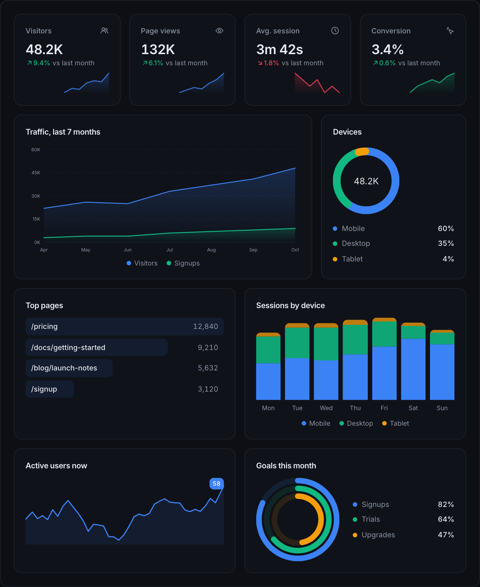
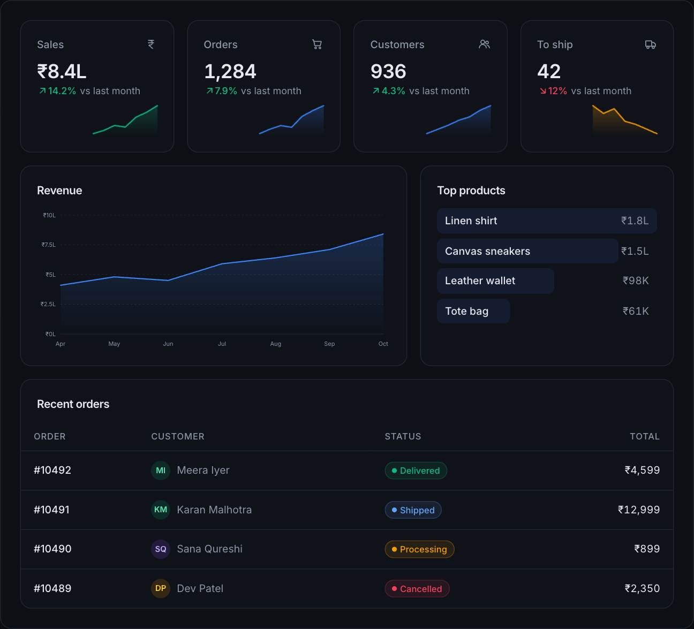
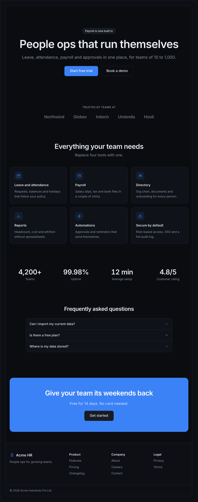
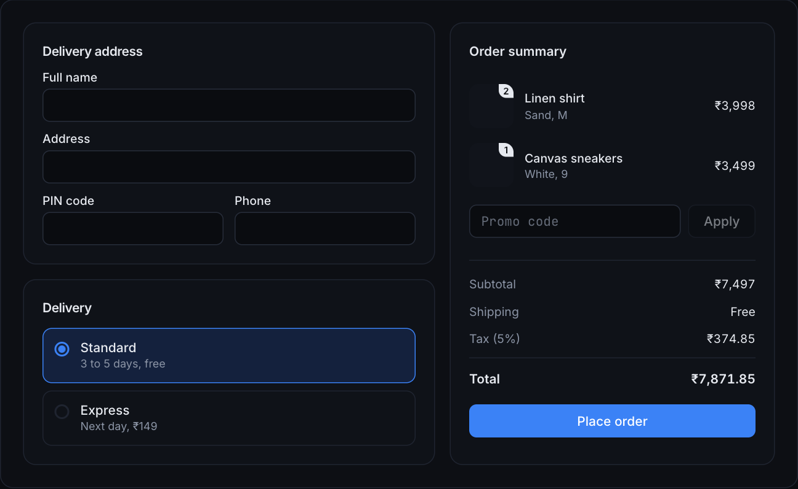
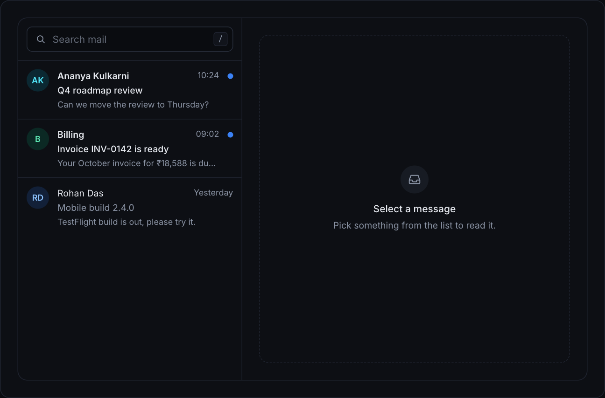
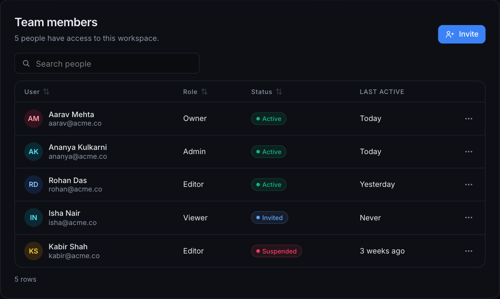

<div align="center">

# befui

**Interfaces people actually enjoy using.**

207 copy-paste React components, 389 hand-drawn icons and 37 full-page blocks.<br/>
Plus **109 Flutter widgets** for Android and iOS, and every component as a `<bef-*>` HTML tag.<br/>
Built on Radix, Tailwind 4 and CSS variables. You own every file.

[](https://react.dev)
[](https://tailwindcss.com)
[](https://www.typescriptlang.org)
[](https://www.radix-ui.com)
[](LICENSE)


</div>

---

## Why befui

- **You own the code.** Every component is one file. The CLI copies it into your project, and from then on it is yours to edit. No package to upgrade or fight with.
- **Real motion, tastefully.** Smooth height animations, a cursor spotlight, a 3D tilt card, a magnifying dock, confetti, a circular theme reveal. All plain CSS and pointer events, all switched off for people who ask for reduced motion.
- **Accessible by default.** Radix handles focus, keyboard and ARIA for dialogs, menus, selects and tabs. The rest follow the same rules.
- **One variable rebrands everything.** Change `--primary` once. Light and dark both follow.
- **Global-ready.** Calendar and date pickers take a `locale`, and components use logical start/end spacing so they flip in right-to-left pages. Every docs preview has an RTL switch.
- **Our own icon set.** 389 icons on one grid with an opt-in draw animation. No icon package.
- **Built for AI coding tools.** `befui init` writes rules into your `AGENTS.md`, and the whole library is described in an `llms.txt` catalog, so an agent reuses components instead of retyping them.

## Quick start

In your app (Vite or similar, with Tailwind 4):

```bash
# 1. one time: theme, helper, and AI rules
npx github:RandomKid24/befui init          # add --force if you want it to replace an existing src/index.css

# 2. add what you need (its npm packages and any components it depends on come along)
npx github:RandomKid24/befui add button card data-table

# or take everything
npx github:RandomKid24/befui add all
```

```tsx
import { Button } from '@/components/ui/button';

export default function Page() {
  return <Button variant="soft" shape="pill">Save changes</Button>;
}
```

That is it. `init` also reminds you of the two config lines to add: the `@` import alias and `import './index.css'` in your entry file. If your project already has a `src/index.css` (Vite's template does), see step 4 of the guide. Full walkthrough in the [setup guide](#setup-guide-from-scratch) below.

## A look around

### Components, each with its own live preview and code


Every component page has a live preview, a Code tab, width and light/dark switches, copy-ready install commands and, for the key ones, a props **Playground**.

### Buttons: 13 variants, each with its own snippet


### Real components you can poke at


### A data table that sorts, filters and paginates


### A kanban board you can drag, or move with the keyboard


### A reports table with search, filters, sorting, row actions and a details drawer


### A sales dashboard from stat cards, line chart, funnel and table


### 389 icons, drawn by us


```tsx
import { SearchIcon, ArrowRightIcon } from '@/components/ui/icons';

<SearchIcon />                    {/* static, 16px, follows text color */}
<ArrowRightIcon draw />           {/* redraws on hover (opt-in) */}
<SearchIcon className="size-6" weight={2.5} />
```

### Time: pickers, clocks and timers

<table>
<tr>
<td width="50%"></td>
<td width="50%"></td>
</tr>
</table>

Time picker, analog clock, world clock, stopwatch, countdown timer and live relative time ("3 minutes ago").

### Whole screens


<table>
<tr>
<td width="50%"><br/><sub>Light</sub></td>
<td width="50%"><br/><sub>Use with AI</sub></td>
</tr>
</table>

## Read more

- [`COMPONENTS.md`](COMPONENTS.md): every component and block in one list, with which have an HTML tag and a Flutter widget.
- [`DESIGN.md`](DESIGN.md): the design rules (colour, type, shape, motion) and how to add a component so it matches.
- [`CHANGELOG.md`](CHANGELOG.md): what changed in each release.

## What is inside

### Use in Flutter (109 widgets)

The mobile components exist as Flutter widgets too, for Android and iOS apps. One Dart file per widget, copy-paste like the React ones, no package to depend on: buttons, inputs, cards, dialogs, sheets, toasts, tabs, bottom nav, charts, calendar, chat, kanban, pickers and more. Colours, radii and the ten palettes come from the same source as the React components, and light and dark both follow.

```bash
npx github:RandomKid24/befui add button badge --flutter   # copies lib/befui/*.dart, theme and icons included
npx github:RandomKid24/befui list --flutter
```

```dart
import 'befui/theme.dart';
import 'befui/button.dart';

MaterialApp(theme: BefTheme.data(), darkTheme: BefTheme.data(brightness: Brightness.dark), home: ...);

BefButton(label: 'Export', variant: BefButtonVariant.soft, onPressed: () {});
```

- Every widget has its own page on the docs site (`/flutter/<name>`) with a working preview, a phone view, the example, the source and a properties table.
- The `befui` MCP server serves them too (`get_component` with `format: "flutter"`, `get_flutter_rules`), and `llms-flutter.txt` lists every widget with an example.
- The runnable gallery is in [`flutter/`](flutter): `cd flutter && flutter run`.

### Use from plain HTML or htmx

Every component page on the docs site has a **Use from HTML** section with the live tags, the HTML and the CSS that component uses (run `npm run dev` to browse it). No React in your app. The built files are committed in [`cdn/`](cdn), so any page can load them from jsDelivr (above). For production pin a commit or tag instead of `@main` (jsDelivr caches `@main` for up to 12 hours), or copy the two files into your project. `npm run build:html` rebuilds them. Every component is a `<bef-*>` tag (`DataTable` is `<bef-data-table>`, `DialogTrigger` is `<bef-dialog-trigger>`).

```html
<link rel="stylesheet" href="https://cdn.jsdelivr.net/gh/RandomKid24/befui@main/cdn/befui.css">
<script type="module" src="https://cdn.jsdelivr.net/gh/RandomKid24/befui@main/cdn/befui.js"></script>

<bef-button variant="soft" shape="pill">Save changes</bef-button>
<bef-progress :value="40"></bef-progress>

<bef-dialog emit="open-change">
  <bef-dialog-trigger as-child><bef-button variant="outline">Open</bef-button></bef-dialog-trigger>
  <bef-dialog-content>
    <bef-dialog-title>Hello</bef-dialog-title>
  </bef-dialog-content>
</bef-dialog>
<script>document.addEventListener('bef:open-change', (e) => console.log(e.detail));</script>
```

- Attributes are props in kebab-case (`default-value`). Strings are the default; use `:` for JSON (`:value="40"`, `:items='[...]'`) and a bare attribute for `true`.
- Callbacks: `emit="value-change"` fires a bubbling `bef:value-change` event with the value in `detail`, so htmx can listen with `hx-trigger="bef:value-change"`.
- Every example in the docs is generated from the React example of the same name (`npm run html:demos`), so the markup is the same one the React demo renders: 194 of the 199 are identical element for element, the other five are clocks and animations that change with time. Buttons that open dialogs, toasts and similar behaviour are wired in small scripts next to the markup (`src/html/glue/`).
- Components in props: put a tag in a JSON string (`:items='[{"icon":"<bef-home-icon></bef-home-icon>"}]'`), or use `slot="icon"` on a child for a single prop.
- Dates: `~to="2026-12-31T09:00"`, or `"~2026-12-31"` inside JSON.
- Controlled components (`value`, `open`, `checked`, `page`...) update themselves: `emit="value-change"` writes the new value back to the tag.
- Functions (table `columns`, render props, `onSubmit`): set them from script, `el.props = { columns }`.
- `style` works on the outer tag; extra Tailwind classes you invent are not in the CSS, so use inline style for layout.
- Works for elements added later (htmx swaps, `innerHTML`) and `hx-*` attributes inside get processed. Radix selects and checkboxes submit with the surrounding `<form>`.
- The CSS does not restyle your page: no `body`, `html` or element rules, and the reset only applies inside `<bef-*>` tags and their popups. The tags are `display: contents`, and component classes are not in a `@layer`, so they win over your own element selectors (`button { }`, `h2 { }`, `nav { }`). Components use Inter and JetBrains Mono like the React site; `befui.css` loads them from Google Fonts (delete the first `@import` line to self-host or opt out). Dark mode is the same `.dark` class on `<html>`.
- Size (`npm run build:html` rebuilds the bundle in `cdn/`): components load on demand. A page with a button and a dialog downloads about **120 KB gzipped** of JavaScript, mostly React; each extra component adds only its own code, a few KB. All 199 together are about 330 KB gzipped. `befui.css` is 117 KB, **18 KB gzipped**. Use `<script type="module">` and serve with gzip or brotli.

## Theming notes

Everything follows the CSS variables in `index.css` (`--primary`, `--ring`, `--accent`...) and the `dark` class on `<html>`. A few pieces use fixed colors on purpose:
- `terminal` is always dark, like a real terminal, in both themes.
- `avatar` and `tag-manager` use fixed tint names (blue, green, violet, amber, rose) so a given name keeps the same color. Edit the `tones` list at the top of each file to match your brand.
- `product-card` discount tags use `destructive`, and `gantt`, `line-chart`, `radar-chart` use the semantic tokens (`primary`, `success`, `warning`, `info`).

### Releasing

Add a `## x.y.z` section to `CHANGELOG.md`, then `npm version minor` (checks the changelog), `git push --follow-tags` and `npm publish` (needs `npm login`; the package name `befui` is free on npm). `prepublishOnly` rebuilds the registry first.

### Keeping animations in sync

Some components (loader, bottom sheet, toast...) need keyframes from `index.css`. After adding components, run `npx github:RandomKid24/befui update` to append any your project is missing (`--check` only reports, handy in CI). `add` also prints a warning when something is missing.

<!-- components:start -->
### Components (207)

<details>
<summary><b>Layout</b> (5)</summary>

`app-shell` · `landing-sections` · `settings-layout` · `sidebar` · `split-pane`

</details>

<details>
<summary><b>Navigation</b> (15)</summary>

`bottom-nav` · `breadcrumb` · `dock` · `menubar` · `navbar` · `navigation-menu` · `onboarding-carousel` · `order-tracker` · `pagination` · `scroll-progress` · `stepper` · `table-of-contents` · `tabs` · `tree-view` · `user-menu`

</details>

<details>
<summary><b>Inputs</b> (42)</summary>

`avatar-upload` · `button` · `button-group` · `calendar` · `checkbox` · `chip` · `color-picker` · `combobox` · `copy-button` · `coupon-input` · `currency-input` · `date-picker` · `datetime-picker` · `dropzone` · `fab` · `file-uploader` · `image-upload` · `inline-edit` · `input` · `input-group` · `label` · `mention-input` · `notification-preferences` · `number-stepper` · `otp-input` · `password-input` · `phone-input` · `radio-group` · `rating` · `rich-text-editor` · `schema-form` · `search-bar` · `search-input` · `segmented` · `select` · `signature-pad` · `slider` · `switch` · `tag-input` · `theme-toggle` · `toggle` · `toggle-group`

</details>

<details>
<summary><b>Display</b> (44)</summary>

`accordion` · `activity-feed` · `approval-flow` · `avatar` · `badge` · `border-beam` · `brand-icons` · `card` · `carousel` · `changelog` · `chat` · `code-block` · `collapsible` · `comment-thread` · `compare` · `credit-card` · `description-list` · `diff-viewer` · `empty-state` · `format` · `invoice` · `kbd` · `marquee` · `onboarding-checklist` · `order-summary` · `pricing-card` · `product-card` · `profile-card` · `rating-breakdown` · `reveal` · `separator` · `shimmer-text` · `sortable-list` · `spotlight-card` · `status-dot` · `swipe-actions` · `table` · `tag-manager` · `terminal` · `testimonial-card` · `tilt-card` · `timeline` · `typewriter` · `version-log`

</details>

<details>
<summary><b>AI</b> (7)</summary>

`ai-message` · `prompt-input` · `prompt-suggestions` · `sources` · `thinking` · `token-meter` · `tool-call`

</details>

<details>
<summary><b>Data</b> (61)</summary>

`area-chart` · `audit-log` · `bar-list` · `box-plot-chart` · `bullet-chart` · `bump-chart` · `butterfly-chart` · `candlestick-chart` · `charts` · `chord-chart` · `circle-pack-chart` · `comparison-table` · `countdown` · `data-table` · `dumbbell-chart` · `file-manager` · `filter-bar` · `forecast-chart` · `funnel-chart` · `gantt` · `gauge` · `half-donut-chart` · `heatmap` · `histogram-chart` · `kanban` · `leaderboard` · `line-chart` · `live-chart` · `lollipop-chart` · `marimekko-chart` · `matrix-heatmap` · `number-ticker` · `org-chart` · `pareto-chart` · `permission-matrix` · `pie-chart` · `pivot-table` · `progress` · `progress-ring` · `punch-card-chart` · `radar-chart` · `radial-bar-chart` · `radial-line-chart` · `ridgeline-chart` · `rose-chart` · `sankey-chart` · `saved-views` · `scatter-chart` · `slope-chart` · `stacked-bar-chart` · `stat-card` · `stream-chart` · `sunburst-chart` · `tree-table` · `treemap` · `uptime-bar` · `venn-chart` · `virtual-list` · `waffle-chart` · `waterfall-chart` · `word-cloud`

</details>

<details>
<summary><b>Feedback</b> (11)</summary>

`alert` · `banner` · `confetti` · `cookie-consent` · `error-state` · `loader` · `notification-center` · `pull-to-refresh` · `skeleton` · `spinner` · `toast`

</details>

<details>
<summary><b>Overlays</b> (12)</summary>

`alert-dialog` · `bottom-sheet` · `command` · `context-menu` · `dialog` · `dropdown-menu` · `hover-card` · `image-viewer` · `popover` · `shortcuts-dialog` · `tooltip` · `tour`

</details>

<details>
<summary><b>Time</b> (9)</summary>

`analog-clock` · `day-agenda` · `event-calendar` · `relative-time` · `stopwatch` · `time-picker` · `timer` · `week-strip` · `world-clock`

</details>

<details>
<summary><b>Other</b> (1)</summary>

`icons`

</details>
<!-- components:end -->

Browse them live with search at the docs site, or run `npx github:RandomKid24/befui list`.

### New in 1.6.0: page blocks








More in `docs/images/block-*.png`: project overview, profile, billing, API keys, invoice, top-nav layout and 404.

<!-- blocks:start -->
### Blocks (37)

Full screens built from the components, with mock data you swap for your own API.

| Block | Module | What it is |
|---|---|---|
| `block:admin-shell` | Layout | Full app frame: grouped sidebar with nested links, topbar with search, alerts and user menu, and a dashboard page. |
| `block:analytics-dashboard` | Dashboard | Visitors, page views, session time and conversion KPIs, a traffic area chart, device donut, top pages bar list and weekday bars. |
| `block:api-keys-page` | Account | Create, reveal, copy and revoke keys, with a masked secret and an empty state. |
| `block:billing-page` | Account | Current plan with seat and storage usage bars, payment method card and an invoice history table. |
| `block:calendar-app` | Productivity | Month and week calendar where you click a day or press New event to add an event in a dialog. |
| `block:campaign-performance` | Marketing | Channel KPIs, weekly leads chart and a campaign budget table. |
| `block:chat-app` | Messaging | Conversation list with unread badges beside a thread with a composer and a typing indicator. |
| `block:checkout-page` | Commerce | Delivery address form with validation, shipping options, coupon code and a live order summary. |
| `block:contact-page` | Marketing | Contact form with validation and a confirmation, beside an FAQ accordion. |
| `block:ecommerce-dashboard` | Commerce | Sales, orders, customers and to-ship KPIs, revenue chart, top products and a recent orders table with status badges. |
| `block:employee-directory` | HRMS | Searchable table with status filter, row selection, actions and pagination. |
| `block:finance-dashboard` | Dashboard | Balance, income, spending and savings rate, a cash-flow chart, spending by category and recent transactions. |
| `block:hrms-overview` | HRMS | Headcount, attendance, department split and activity feed. |
| `block:inbox` | Layout | Two-pane mail view: searchable list with unread dots, message reader with reply, archive and delete. Single pane on mobile. |
| `block:invoice-page` | Commerce | A full invoice with print, download and send actions. |
| `block:kanban-board-page` | Dashboard | Full-page board with search, a priority filter, column totals and a dialog for each task. Drag a card or move it with Alt and the arrow keys. |
| `block:landing-page` | Landing | Whole marketing page: navbar, hero, logos, feature grid, stats, FAQ, call to action and footer. |
| `block:lead-pipeline` | Marketing | Drag-and-drop board with column totals and a keyboard-friendly move button. |
| `block:leave-approvals` | HRMS | Manager inbox with tabs, balance bars and approve or reject toasts. |
| `block:leave-request-form` | HRMS | Date range, approver combobox, multi-select notify list, working-day count and field validation. |
| `block:not-found-page` | Layout | Full-page 404 with search and two ways out. Reuse for 403 and 500. |
| `block:notifications-page` | Account | Full-page inbox with All and Unread tabs, mark as read and mark all read. |
| `block:onboarding-wizard` | Account | Four-step setup (profile, team, preferences, done) with a stepper, validation and values kept when you go back. |
| `block:otp-verify` | Auth | Six-digit code entry with a resend countdown, an error state and a success screen. |
| `block:pricing-page` | Marketing | Headline, monthly or yearly switch, three plan cards with a highlighted one, and an FAQ. |
| `block:profile-page` | Account | Cover and avatar header with actions, then About (details list) and Activity (timeline) tabs. |
| `block:project-overview` | Dashboard | Project header with status and team, progress ring with phase bars, task list and a milestone timeline. |
| `block:reports-table` | Reports | Searchable, filterable, sortable reports table with row action menus and a details drawer. |
| `block:reset-password` | Auth | Four steps: ask for email, check your inbox with a resend timer, choose a new password, done. |
| `block:sales-dashboard` | Marketing | KPI cards, revenue line chart against target, pipeline funnel and a top deals table. |
| `block:server-error-page` | Layout | A 500 page with a retry that loads, a status link and a short incident timeline. |
| `block:settings-page` | Account | Profile form with photo and phone number, notification switches and language and time zone, in tabs. |
| `block:sign-in` | Auth | Login card with validation, loading button and an error alert. |
| `block:sign-up` | Auth | Registration card with name, email, password strength meter, terms checkbox, validation and a check-your-inbox confirmation. |
| `block:team-page` | Marketing | Heading, a grid of team members with roles and short bios, and a hiring call to action. |
| `block:top-nav-layout` | Layout | App frame with a top navigation bar instead of a sidebar, with notifications, theme toggle and user menu. |
| `block:user-management` | Account | Team members table with search, sort, role and status, row actions (suspend, remove) and an invite dialog with validation. |
<!-- blocks:end -->

### Icons (389)

Arrows, status, people, files, media, devices, commerce, charts, text formatting, maps and actions on a 24px grid, round strokes, one file. See them all on the Icons page of the site.

---

## Setup guide, from scratch

New to this? Follow these steps in a fresh project. Already have Tailwind 4 and the `@` alias? Skip to [Using components](#using-components).

**1. Create a Vite + React + TypeScript app**

```bash
npm create vite@latest my-app -- --template react-ts
cd my-app
```

**2. Install Tailwind 4**

```bash
npm i tailwindcss @tailwindcss/vite
```

**3. Add the `@` alias** (components import each other and the helper through `@/`)

`vite.config.ts`
```ts
import path from 'path';
import { defineConfig } from 'vite';
import react from '@vitejs/plugin-react';
import tailwindcss from '@tailwindcss/vite';

export default defineConfig({
  plugins: [react(), tailwindcss()],
  resolve: { alias: { '@': path.resolve(__dirname, 'src') } },
});
```

`tsconfig.app.json` (inside `compilerOptions`)
```json
"paths": { "@/*": ["./src/*"] }
```

You will also need `npm i -D @types/node` for the `path` import.

**4. Run init**

```bash
npx github:RandomKid24/befui init --force
```

`--force` is needed here because the Vite template already ships its own `src/index.css`, and without it `init` leaves that file alone and tells you it skipped. In a project where you have your own CSS, run plain `init` and paste the theme variables from `src/index.css` in this repo into yours instead.

This writes `src/index.css` (theme variables and animations), `src/lib/utils.ts` (the `cn` helper) and an `AGENTS.md` block for AI tools, and installs the shared packages.

**5. Make sure the CSS is imported once**

The Vite template already has this line in `src/main.tsx`. If yours does not, add it:

```tsx
import './index.css';
```

**6. Add a component and use it**

```bash
npx github:RandomKid24/befui add button dialog toast
```

```tsx
import { Button } from '@/components/ui/button';
import { Toaster, toast } from '@/components/ui/toast';

export default function App() {
  return (
    <>
      <Button onClick={() => toast.success('Saved')}>Save</Button>
      <Toaster />
    </>
  );
}
```

## Using components

- **Props are typed.** Your editor shows them. Variants use [`cva`](https://cva.style), so `variant`, `size` and friends autocomplete.
- **Override with `className`.** It is merged with `cn`, so your classes win over the defaults.
- **Some components need a provider or a root element.** `Toaster` goes once near the app root. `TooltipProvider` wraps anything that uses `Tooltip`. Each component page says so.
- **Compose them.** Blocks are just components arranged into a screen. Copy one with `add block:leave-approvals` and read how it is built.
- **Edit freely.** The files are in your repo. Change a padding, add a prop, delete what you do not use.
- **Next.js.** Components that use state, Radix or browser APIs start with `'use client'`, so they work in the App Router with nothing to configure. Purely presentational ones (cards, badges, tables, icons) stay server components.
- **Right-to-left.** Spacing uses start and end, so layouts flip on their own. Arrow keys inside Radix menus, tabs and toggle groups need the direction too: wrap your app in `DirectionProvider` from `@radix-ui/react-direction`, or pass `dir` to the component.

To pull the latest version of a component later:

```bash
npx github:RandomKid24/befui add button --force   # overwrites your local edits to that file
```

## Theming

Every color is a CSS variable in `src/index.css`. To rebrand, change four lines:

```css
:root {
  --primary: #7c3aed;
  --ring: #8b5cf6;
  --accent: #f5f3ff;
  --accent-foreground: #6d28d9;
}
```

Dark mode switches when `<html>` has the `dark` class:

```ts
document.documentElement.classList.toggle('dark');
```

Want the circular reveal the docs site uses? It is a few lines around `document.startViewTransition`, see `useTheme` in `src/site/layout.tsx`.

## CLI reference

| Command | What it does |
|---|---|
| `befui init` | Adds `index.css`, `lib/utils.ts`, installs shared packages and writes the AI rules to `AGENTS.md`. `--theme rose` also sets the colours (see the Themes page) |
| `befui add <name...>` | Copies components, plus the components and npm packages they need |
| `befui mcp` | Runs an MCP server so Claude Code, Cursor etc. can list, read and add components (`init` registers it in `.mcp.json`) |
| `befui add all` | Copies every component |
| `befui add block:<name>` | Copies a block (and what it uses) |
| `befui list` | Lists everything available |
| `befui diff <name...>` | Shows how your copy of a component differs from the latest (`-` is yours, `+` is the latest) |
| `befui remove <name...>` | Deletes a component's files. Refuses while another file imports it, unless `--force`. Packages it needed stay installed |

| Flag | Meaning |
|---|---|
| `--dir <path>` | Target folder. Default `src` (or `.` if there is none) |
| `--force` | Overwrite files that already exist (for `remove`: remove even if other files import it) |
| `--theme <name>` | With `init`: write a ready palette (blue, indigo, violet, rose, red, emerald, teal, amber, orange, slate) into `index.css` |
| `--no-install` | Print the npm packages instead of installing them |
| `--from <folder or url>` | Read the registry from somewhere else. Also `BEFUI_URL` |

Until the package is published to npm, run it as `npx github:RandomKid24/befui ...`. It detects npm, pnpm, yarn or bun from your lockfile.

## Using befui with AI

The library is set up so a coding agent (Claude Code, Cursor, Copilot) uses it correctly without hand-holding.

1. Run `npx github:RandomKid24/befui init`. It writes a marked block into `AGENTS.md` telling agents to reuse befui components, add missing ones with the CLI and use the theme tokens. Re-running refreshes only that block.
2. `init` also registers the **MCP server** in `.mcp.json` (restart your AI tool). Agents then get `list_components`, `get_component` (exact source, import, example; `format: "html"` for the `<bef-*>` tags and an HTML example), `get_html_rules` and `add_components` (use `all` for the whole library). Without `init`: `claude mcp add befui -- npx -y github:RandomKid24/befui mcp`.
3. **Claude Code** reads `CLAUDE.md`, so add the line `@AGENTS.md` to it. Cursor and Copilot read `AGENTS.md` directly.
4. Just ask: *"Build a leave-approvals page with befui. Check llms-full.txt first."*

The catalog for agents is plain text, regenerated on every build:

- [`public/llms.txt`](public/llms.txt): short index of every component
- [`public/llms-full.txt`](public/llms-full.txt): every component with its import line, dependencies and a working example

## Storybook

```bash
npm run storybook          # http://localhost:6006
npm run build-storybook    # static copy in dist-storybook
```

One story per component and block, generated from the same registry as the docs site. The toolbar has a light/dark switch and an accessibility panel.

## Run the docs site

```bash
git clone https://github.com/RandomKid24/befui
cd befui
npm install
npm run dev
```

| Script | Purpose |
|---|---|
| `npm run dev` | Docs site with hot reload |
| `npm run build` | Rebuilds the registry, typechecks and builds the site |
| `npm run typecheck` | TypeScript only |
| `npm run registry:build` | Regenerates `public/r/*.json`, `llms.txt` and `llms-full.txt` |
| `npm run stories:gen` | Regenerates the Storybook stories |
| `npm run storybook` | Storybook dev server |

## Project structure

```
src/
  components/ui/     the components, one file each (this is what gets copied)
  examples/          one demo per component, shown on its docs page
  blocks/            full-page blocks
  registry/index.ts  the list of components and blocks (docs, search, CLI and stories read it)
  site/              the docs site itself, built from the components above
  html/              the <bef-*> build: runtime (entry.ts), generated examples (demos/), hand-written behaviour (glue/), per-component CSS (css/)
  stories/           generated Storybook stories (do not edit)
public/r/            registry JSON the CLI downloads
public/llms*.txt     catalog for AI tools
cdn/                 the built HTML bundle (befui.js, chunks/, befui.css), served from jsDelivr
bin/befui.mjs        the CLI
scripts/             registry, stories and AI-rules generators
```

## Contributing a component

1. Create `src/components/ui/<slug>.tsx`. Keep it to one file, import other befui files as `./other` and use the `cn` helper.
2. Create `src/examples/<slug>.tsx` with a default-exported demo.
3. Add an entry to `src/registry/index.ts`. The docs page, search, sidebar, CLI, llms files and Storybook story all come from it.
4. Run `npm run build`. It must pass.

Style rules we keep: use theme tokens (`bg-primary`, `text-muted-foreground`), never hard-coded colors; no gradients; respect `prefers-reduced-motion`; keyboard and screen-reader support are not optional.

## FAQ

**Is this an npm package?** Not yet. You copy files, or let the CLI copy them. That is the point: nothing to version-lock.

**What does it depend on?** React 19, Tailwind 4, Radix primitives for behavior, `lucide-react` for icons in the older components, and `cmdk` for the command palette and combobox. The newer components use our own icons, and the animated pieces need no libraries.

**Does it work with Next.js?** I have only tested it with Vite. The components are plain React and Tailwind, so it should work: add `'use client'` to files that use state or effects and set up the `@` alias in your `tsconfig`.

**How do I update a component?** `add <name> --force`, then re-apply any edits you made. Check `git diff` first.

## License

MIT. See [LICENSE](LICENSE).
